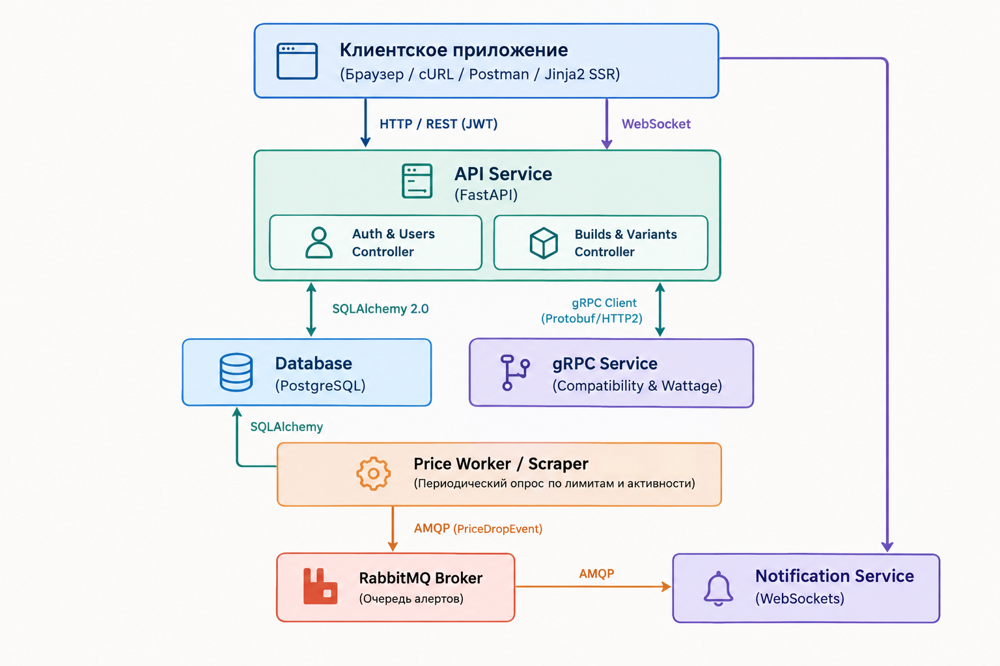

# PC tracker
Конфигуратор сборок ПК с проверкой совместимости комплектующих и трекером цен маркетплейсов.

Выбор и описание предметной области. Проектирование функционала приложения. 

Содержание:
- [1. Введение](#1-введение)
  - [1.1. Описание предметной области](#11-описание-предметной-области)
  - [1.2. Задачи создания информационной системы](#12-задачи-создания-информационной-системы)
- [2. Сценарии использования](#2-сценарии-использования)
  - [2.1. Роли пользователей](#21-роли-пользователей)
  - [2.2. Use Cases](#22-use-cases)
- [3. Архитектура приложения](#3-архитектура-приложения)
  - [3.1. Используемые технологии](#31-используемые-технологии)
  - [3.2. Диаграмма компонентов системы](#32-диаграмма-компонентов-системы)
- [4. Структура базы данных](#4-структура-базы-данных)
  - [4.1. Логическая схема базы данных](#41-логическая-схема-базы-данных)
  - [4.2. Физическая схема данных](#42-физическая-схема-данных)

## 1. Введение

### 1.1. Описание предметной области
Рынок комплектующих для персональных компьютеров характеризуется высокой изменчивостью цен, широким разбросом предложений между торговыми площадками (DNS, маркетплейсы Ozon, Wildberries и др.) и сложной системой аппаратной совместимости компонентов. 

Пользователи, планирующие сборку нового ПК или поэтапную модернизацию существующей системы, сталкиваются со следующими проблемами:
1. **Временные затраты на ручной мониторинг:** цены и скидочные предложения на комплектующие меняются ежедневно, а наличие товара на складах нестабильно.
2. **Риск несовместимости компонентов:** при ручном подборе комплектующих высока вероятность ошибки (несовпадение процессорного сокета и чипсета материнской платы, типа оперативной памяти, нехватка мощности блока питания или несоответствие габаритов кулера/видеокарты размерам корпуса).
3. **Отсутствие гибкой вариативности:** большинство существующих конфигураторов не позволяют прикрепить несколько альтернативных вариантов комплектующих (например, две разные модели видеокарт с возможностью быстрого переключения и сравнения итоговой стоимости) и связать их с конкретными ссылками на маркетплейсы с учетом условий доставки.

### 1.2. Задачи создания информационной системы
Целью разработки является создание распределенной веб-системы «Конфигуратор сборок ПК с модулем валидации совместимости и трекером динамики цен маркетплейсов», решающей задачи:
* Предоставление пользователю интерактивного конструктора конфигураций ПК (сборок) с поддержкой альтернативных вариантов комплектующих и учетом их количества (включая комплекты модулей памяти).
* Автоматическая валидация аппаратной совместимости и расчет энергопотребления на базе изолированного синхронного микросервиса (**gRPC**).
* Ведение персонализированных списков вариантов покупки (DNS, Ozon, Wildberries) с датами доставки и пользовательскими комментариями.
* Контроль нагрузки на парсинг: отслеживание цен только на целевые позиции с ограничением лимитов и автоматической приостановкой опроса при неактивности пользователя.
* Двухуровневая модерация моделей комплектующих для предотвращения замусоривания каталога.
* Доставка мгновенных уведомлений о снижении цен через событийно-ориентированную шину (**RabbitMQ**) и сокет-соединения (**WebSocket**).

---

## 2. Сценарии использования

### 2.1. Роли пользователей
В системе предусмотрено 3 роли:
1. **Обычный пользователь (Standard User):**
   * Создание и редактирование до 3 сборок ПК.
   * Клонирование существующих сборок.
   * Использование базового сервиса проверки совместимости (доступен бесплатно всем).
   * Добавление новых моделей комплектующих (с обязательной отправкой на модерацию).
   * Создание до 12 одновременно отслеживаемых вариантов покупки (`is_tracked = True`).
   * Получение уведомлений о снижении цен в реальном времени.
2. **Премиум-пользователь (Premium User):**
   * Неограниченное количество сборок и отслеживаемых вариантов покупки.
   * Приоритетный интервал проверки цен фоновым воркером.
3. **Администратор (Admin):**
   * Модерация предложенных пользователями моделей: проверка технических характеристик (JSON-спецификаций), одобрение (`APPROVED`) или отклонение (`REJECTED`).
   * Сквозной аудит ссылок: просмотр всех вариантов покупки, привязанных пользователями к конкретной модели.
   * Управление категориями комплектующих.

---

### 2.2. Use Cases

#### Сценарий UC-1: Регистрация и аутентификация
**Действия пользователя:** Вводит email и пароль на странице авторизации $\to$ отправляется запрос `POST /api/auth/register` (или `/login`) $\to$ система валидирует данные с помощью Pydantic, хэширует пароль и возвращает JWT-токен $\to$ токен сохраняется клиентом и передается в заголовке `Authorization: Bearer <token>` во всех последующих запросах. При логине обновляется поле `last_login_at` пользователя.

#### Сценарий UC-2: Создание сборки и добавление вариативных комплектующих
**Действия пользователя:** 

1. Создает сборку: указывает название (*«Рабочая станция 2026»*) и описание $\to$ `POST /api/builds`.
2. В слот «Процессор» выбирает утвержденную модель из каталога.
3. В слот «Оперативная память» выбирает модуль памяти, указывает `quantity = 2` (две планки).
4. В слот «Видеокарта» добавляет две альтернативные модели (например, *RTX 4070 Super* и *RX 7800 XT*), помечая одну из них как активную (`is_active_variant = True`).
5. При необходимости дублирует сборку в один клик $\to$ `POST /api/builds/{id}/clone`.

#### Сценарий UC-3: Проверка совместимости через gRPC
**Действия пользователя:** Открывает экран сборки или переключает активную видеокарту.

**Внутренняя логика системы:**
1. FastAPI извлекает спецификации всех активных компонентов сборки с учетом их количества (`quantity` и `kit_count`).
2. Формирует Protobuf-сообщение `CompatibilityRequest` и отправляет синхронный RPC-запрос в **gRPC Compatibility Service**.
3. gRPC-сервис валидирует правила:
  * Совпадение сокета CPU и материнской платы (`AM5 == AM5`).
  * Тип памяти RAM и платы (`DDR5 == DDR5`).
  * Количество модулей ОЗУ ($\text{quantity} \times \text{kit count} \le \text{слотов платы}$).
  * Габариты: длина видеокарты $\le$ максимальной длины в корпусе; высота кулера $\le$ ширины корпуса.
  * Энергопотребление: $\sum \text{TDP} + 150 \text{ Вт} \le \text{мощности БП}$.
4. gRPC-сервис возвращает ответ `CompatibilityResponse` с булевым статусом, расчетной мощностью и списком ошибок/предупреждений.
5. Пользователь видит интерактивный статус совместимости (зеленый/красный) с детальным описанием конфликтов.

#### Сценарий UC-4: Добавление пользовательской модели и модерация
**Действия пользователя:** Пользователь не находит нужный корпус в каталоге $\to$ заполняет форму (название, категория «Корпуса», спецификации: макс. длина GPU, высота кулера) $\to$ `POST /api/models`.

**Логика системы:** Модель создается в статусе `PENDING_REVIEW` с привязкой `created_by_user_id`. Модель доступна только создавшему ее пользователю. В очередь RabbitMQ отправляется событие `new_model_submitted`.

**Действия администратора:** В панели модератора открывает список заявок `GET /api/admin/pending-models`, проверяет корректность параметров, нажимает «Одобрить» $\to$ `PATCH /api/admin/models/{id}/approve`. Модель получает статус `APPROVED` и становится доступна всем в глобальном каталоге.

#### Сценарий UC-5: Добавление вариантов покупки (StoreVariant) и настройка трекинга
**Действия пользователя:**

1. В карточке комплектующего нажимает «Добавить вариант покупки» $\to$ `POST /api/variants`.
2. Указывает: название (*«Ozon со склада РФ»*), площадку (`OZON`), URL, ожидаемую дату доставки (*«до 12 мая»*), комментарий (*«проверенный продавец»*).
3. Включает тумблер `is_tracked = True`.
4. Система проверяет квоту: для базового пользователя лимит активных треков — не более 12. Если лимит превышен, выдается ошибка с предложением перейти на Premium или отключить трекинг на других товарах.

#### Сценарий UC-6: Обработка изменения цен и Real-Time уведомления
**Логика системы:**

1. Фоновый воркер проверяет цены только для вариантов, у которых `is_tracked = True`, `is_in_stock = True`, а владелец заходил в систему (`last_login_at`) не более 30 дней назад.
2. Если товар закончился на маркетплейсе, выставляется `is_in_stock = False`. Если товар отсутствует более 14 дней — опрос замораживается.
3. При обнаружении снижения цены воркер обновляет `current_price`, делает запись в `price_history` и публикует сообщение `PriceDropEvent` в брокер **RabbitMQ**.
4. **Notification Service** считывает событие из очереди и пересылает JSON-уведомление через постоянное **WebSocket**-соединение в браузер пользователя.
5. Пользователь видит всплывающее push-уведомление с цветовым бейджем магазина и разницей в цене.

---

## 3. Архитектура приложения

### 3.1. Используемые технологии

1. **FastAPI (REST API Gateway / Core Service):**
   * *Обоснование:* современный высокопроизводительный асинхронный Python-фреймворк с автоматической валидацией через Pydantic, встроенной генерацией OpenAPI (Swagger) и нативным механизмом Dependency Injection.
2. **PostgreSQL + SQLAlchemy 2.0 (ORM):**
   * *Обоснование:* надежная реляционная СУБД с полной поддержкой ACID. Наличие типа данных `JSONB` позволяет гибко хранить технические спецификации различных категорий комплектующих (у процессора — сокет и TDP, у материнской платы — чипсет и слоты ОЗУ, у корпуса — габариты) без создания десятков разреженных таблиц.
3. **gRPC + Protocol Buffers (Compatibility Service):**
   * *Обоснование:* бинарный протокол поверх HTTP/2 обеспечивает строго типизированный контракт (`.proto`), минимальный оверхед на сериализацию и высокую скорость вычислений. Вынесение алгоритма проверки совместимости в микросервис изолирует ресурсоемкую логику от основного веб-потока.
4. **RabbitMQ (Message Broker):**
   * *Обоснование:* надежный AMQP-брокер, обеспечивающий асинхронную развязку (decoupling). Сервис сбора цен или Core API не блокируются в ожидании отправки оповещений клиентам.
5. **WebSocket (Notification Service):**
   * *Обоснование:* дуплексный сетевой протокол с минимальным служебным заголовком. Позволяет серверу мгновенно инициировать передачу алертов о снижении цен в интерфейс пользователя без регулярного клиентского polling.
6. **Docker & Docker Compose:**
   * *Обоснование:* обеспечение воспроизводимости среды и декларативного оркестрирования всех 5 контейнеров системы единой командой.
7. **Jinja2 (SSR Web Interface):**
   * *Обоснование:* серверный рендеринг страниц интерфейса без усложнения стека сторонними SPA-фреймворками, прямая интеграция с сервисным слоем FastAPI.

---

### 3.2. Диаграмма компонентов системы

---

## 4. Структура базы данных

### 4.1. Логическая схема базы данных

1. **`users` $\to$ `builds`** (1 : M) — один пользователь может иметь несколько сборок.
2. **`users` $\to$ `store_variants`** (1 : M) — пользователь создает свои варианты покупки со ссылками на маркетплейсы.
3. **`users` $\to$ `component_models`** (1 : M) — пользователь может предложить модель на модерацию (поле `created_by_user_id`).
4. **`categories` $\to$ `component_models`** (1 : M) — категория объединяет множество моделей (CPU, GPU, RAM и т.д.).
5. **`component_models` $\to$ `store_variants`** (1 : M) — к одной модели комплектующего может быть привязано множество вариантов предложений разных магазинов.
6. **`store_variants` $\to$ `price_history`** (1 : M) — вариант покупки имеет хронологию изменения цен.
7. **`builds` $\leftrightarrow$ `component_models`** через таблицу **`build_items`** (**Связь Многие-ко-многим (M:N)**) — в сборку входит множество моделей, а одна модель может фигурировать в разных сборках. Промежуточная таблица хранит дополнительные атрибуты: количество (`quantity`), флаг активности ветки (`is_active_variant`) и выбранный вариант покупки (`selected_variant_id`).

---

### 4.2. Физическая схема данных

#### Таблица: `users`
| Поле | Тип данных | Ограничения | Описание |
| :--- | :--- | :--- | :--- |
| `id` | `UUID` / `BIGSERIAL` | PRIMARY KEY | Идентификатор пользователя |
| `email` | `VARCHAR(255)` | NOT NULL, UNIQUE | Электронная почта |
| `hashed_password` | `VARCHAR(255)` | NOT NULL | Хэш пароля (bcrypt/argon2) |
| `role` | `VARCHAR(20)` | NOT NULL, DEFAULT 'USER' | Роль: `USER`, `PREMIUM`, `ADMIN` |
| `last_login_at` | `TIMESTAMP WITH TZ` | NOT NULL | Время последней активности (для TTL трекинга) |
| `created_at` | `TIMESTAMP WITH TZ` | NOT NULL, DEFAULT NOW() | Дата регистрации |

#### Таблица: `categories`
| Поле | Тип данных | Ограничения | Описание |
| :--- | :--- | :--- | :--- |
| `id` | `SERIAL` | PRIMARY KEY | Идентификатор категории |
| `name` | `VARCHAR(100)` | NOT NULL, UNIQUE | Название (Процессоры, ОЗУ, Корпуса и т.д.) |
| `slug` | `VARCHAR(100)` | NOT NULL, UNIQUE | Символьный код (`cpu`, `gpu`, `ram`) |

#### Таблица: `component_models`
| Поле | Тип данных | Ограничения | Описание |
| :--- | :--- | :--- | :--- |
| `id` | `BIGSERIAL` | PRIMARY KEY | Идентификатор модели детали |
| `category_id` | `INT` | NOT NULL, REFERENCES `categories(id)` | Категория детали |
| `created_by_user_id` | `BIGINT` | NULL, REFERENCES `users(id)` | Автор (NULL — если создана админом) |
| `name` | `VARCHAR(255)` | NOT NULL | Название (напр., "Core i5-13600K") |
| `brand` | `VARCHAR(100)` | NOT NULL | Производитель (Intel, AMD, ASUS) |
| `specs` | `JSONB` | NOT NULL, DEFAULT '{}' | Технические параметры для gRPC (TDP, сокет, размеры, kit_count) |
| `status` | `VARCHAR(20)` | NOT NULL, DEFAULT 'PENDING' | Статус: `PENDING_REVIEW`, `APPROVED`, `REJECTED` |
| `created_at` | `TIMESTAMP WITH TZ` | NOT NULL, DEFAULT NOW() | Дата создания |

#### Таблица: `store_variants`
| Поле | Тип данных | Ограничения | Описание |
| :--- | :--- | :--- | :--- |
| `id` | `BIGSERIAL` | PRIMARY KEY | Идентификатор варианта предложения |
| `component_model_id`| `BIGINT` | NOT NULL, REFERENCES `component_models(id)`| Привязка к модели детали |
| `created_by_user_id`| `BIGINT` | NOT NULL, REFERENCES `users(id)` | Владелец ссылки |
| `custom_name` | `VARCHAR(255)` | NOT NULL | Метка (*«Ozon доставка со склада РФ»*) |
| `shop_type` | `VARCHAR(30)` | NOT NULL | Площадка: `OZON`, `WILDBERRIES`, `DNS`, `OTHER` |
| `url` | `TEXT` | NOT NULL | URL-ссылка на товар |
| `delivery_info` | `VARCHAR(255)` | NULL | Срок доставки (*«до 15 мая»*, *«3 дня»*) |
| `comment` | `TEXT` | NULL | Заметка пользователя |
| `current_price` | `NUMERIC(12, 2)` | NOT NULL | Текущая зафиксированная цена |
| `is_in_stock` | `BOOLEAN` | NOT NULL, DEFAULT TRUE | Наличие товара на площадке |
| `is_active` | `BOOLEAN` | NOT NULL, DEFAULT TRUE | Включен ли в калькуляцию сборки |
| `is_tracked` | `BOOLEAN` | NOT NULL, DEFAULT FALSE | Стоит ли на фоновом мониторинге |
| `last_checked_at` | `TIMESTAMP WITH TZ` | NULL | Время последней проверки цены |

#### Таблица: `price_history`
| Поле | Тип данных | Ограничения | Описание |
| :--- | :--- | :--- | :--- |
| `id` | `BIGSERIAL` | PRIMARY KEY | Идентификатор записи истории |
| `variant_id` | `BIGINT` | NOT NULL, REFERENCES `store_variants(id)` ON DELETE CASCADE | Ссылка на вариант |
| `price` | `NUMERIC(12, 2)` | NOT NULL | Зафиксированная цена |
| `recorded_at` | `TIMESTAMP WITH TZ` | NOT NULL, DEFAULT NOW() | Время фиксации цены |

#### Таблица: `builds`
| Поле | Тип данных | Ограничения | Описание |
| :--- | :--- | :--- | :--- |
| `id` | `BIGSERIAL` | PRIMARY KEY | Идентификатор сборки ПК |
| `user_id` | `BIGINT` | NOT NULL, REFERENCES `users(id)` ON DELETE CASCADE | Владелец сборки |
| `name` | `VARCHAR(255)` | NOT NULL | Название (*«Сборка для монтажа»*) |
| `description` | `TEXT` | NULL | Описание/цели сборки |
| `created_at` | `TIMESTAMP WITH TZ` | NOT NULL, DEFAULT NOW() | Дата создания |
| `updated_at` | `TIMESTAMP WITH TZ` | NOT NULL, DEFAULT NOW() | Дата обновления |

#### Таблица: `build_items` (Связующая M:N)
| Поле | Тип данных | Ограничения | Описание |
| :--- | :--- | :--- | :--- |
| `id` | `BIGSERIAL` | PRIMARY KEY | Идентификатор позиции сборки |
| `build_id` | `BIGINT` | NOT NULL, REFERENCES `builds(id)` ON DELETE CASCADE | Ссылка на сборку |
| `component_model_id`| `BIGINT` | NOT NULL, REFERENCES `component_models(id)`| Модель комплектующего |
| `category_id` | `INT` | NOT NULL, REFERENCES `categories(id)` | Категорийный слот в сборке |
| `quantity` | `INT` | NOT NULL, DEFAULT 1 | Количество (напр., 2 планки памяти) |
| `is_active_variant` | `BOOLEAN` | NOT NULL, DEFAULT TRUE | Активна ли данная модель при ветвлении |
| `selected_variant_id`| `BIGINT` | NULL, REFERENCES `store_variants(id)` | Выбранный магазин для подсчета цены |

