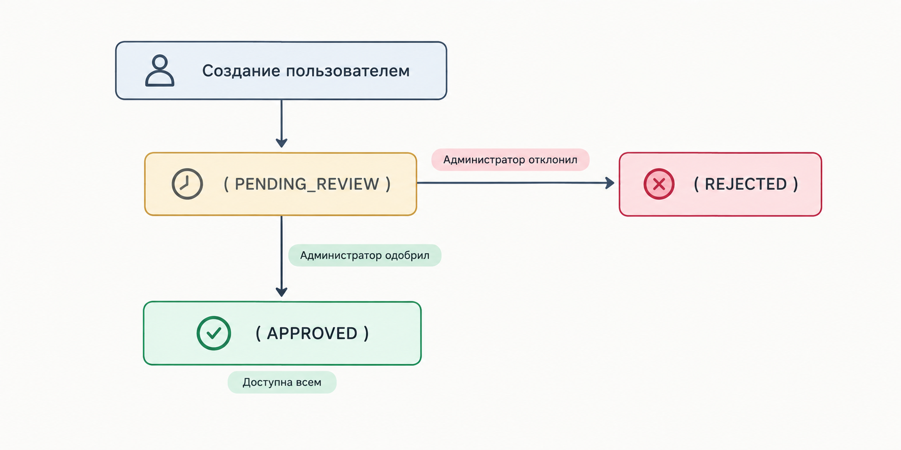
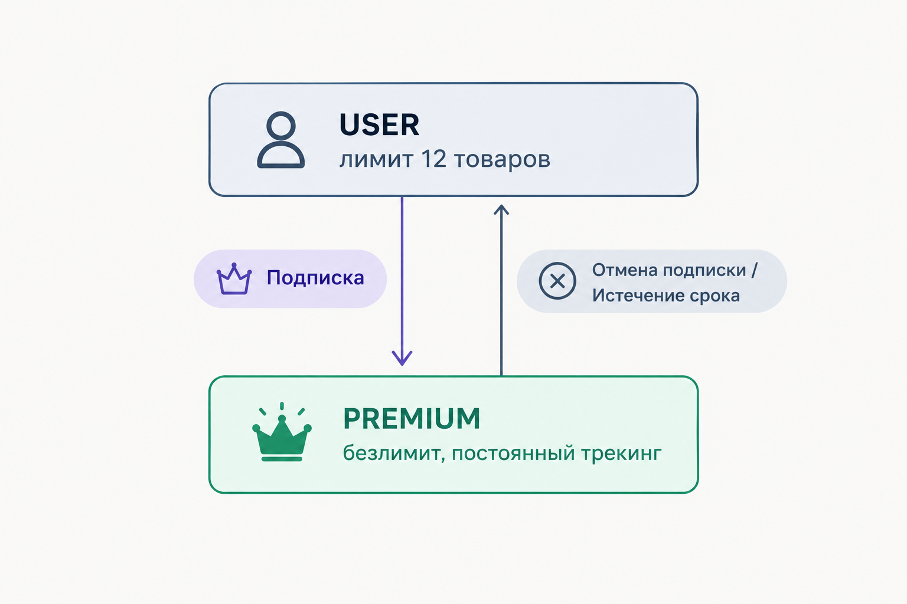

# Тестирование проекта
В это документе описана стратегия автоматизированного тестирования распределенной системы мониторинга цен комплектующих ПК и верификации аппаратной совместимости конфигураций. В область автоматизированного тестирования входит:

* **Слой хранения данных (Data Layer / ORM):** проверка ограничений целостности реляционной схемы PostgreSQL, транзакционных механизмов и каскадных операций удаления.
* **Сетевой интерфейс приложения (REST API Gateway):** проверка входных данных (DTO), аутентификация и авторизация (JWT), ролевая модель доступа (RBAC), управление квотами и бизнес-логика конструктора сборок.
* **Служебный микросервис совместимости (RPC Layer):** проверка бинарного контракта Protocol Buffers и алгоритмов проверки совместимости комплектующих (CPU, Motherboard, RAM, GPU, Case, PSU).


Содержание:
- [Запуск](#запуск)
- [Анализ граничных значений](#анализ-граничных-значений)
- [Таблица решений](#таблица-решений)
- [Эквивалентное разделение](#эквивалентное-разделение)
- [Тестирование переходов состояний](#тестирование-переходов-состояний)
- [Матрица трассируемости требований](#матрица-трассируемости-требований)
  - [Уровень: Data](#уровень-data)
  - [Уровень: API](#уровень-api)
  - [Уровень: RPC](#уровень-rpc)
- [Архитектура изоляции тестовых данных](#архитектура-изоляции-тестовых-данных)

##  Запуск
**Запуск полного набора тестов:**

```bash
pytest
```

**Запуск тестов конкретного архитектурного слоя:**

```bash
# Только тесты слоя данных (ORM и ограничения БД):
pytest tests/test_orm.py

# Только тесты сетевого слоя (REST API):
pytest tests/test_api.py

# Только тесты удаленного взаимодействия (gRPC):
pytest tests/test_grpc.py

# Только тесты парсинга URL (WB):
pytest tests/test_wb.py -k "UrlParsing"

# 2. Только тесты с реальным браузером (WB):
pytest tests/test_wb.py
```

##  Анализ граничных значений

**Границы длины пароля пользователя (Требование: пароль ≥ 6 символов)**
* **Класс невалидных значений:** Длина 0, 3, 5 символов.
* **Граница перехода:** 5 → 6 символов.
* **Класс валидных значений:** 6, 7+ символов.
* **Реализация:** Параметризованный тест `test_registration_short_password_validation` проверяет граничные невалидные значения (123, abc, пустая строка), ожидая ответ HTTP 422 Unprocessable Entity.

**Границы квоты активного мониторинга цен (Требование: базовый тариф ≤ 12 товаров)**
* **Класс допустимых значений:** От 1 до 12 отслеживаемых позиций.
* **Граничное значение:** 12 товаров (успешно).
* **Запредельное значение:** 13-й товар (блокировка).
* **Реализация:** Тест `test_quota_limit_exceeded_for_basic_user` последовательно создает 12 вариантов покупки с флагом `is_tracked = True` (успех HTTP 201), после чего создание 13-й позиции блокируется с кодом HTTP 403 Forbidden.

## Таблица решений
| Условие (Правило) | Правило 1 | Правило 2 | Правило 3 | Правило 4 | Правило 5 |
| :--- | :---: | :---: | :---: | :---: | :---: |
| Совпадение сокета (CPU == MB) | ДА | **НЕТ** | ДА | ДА | ДА |
| Тип оперативной памяти (RAM == MB) | ДА | ДА | **НЕТ** | ДА | ДА |
| Число планок $\le$ числу слотов MB | ДА | ДА | ДА | **НЕТ** | ДА |
| Длина GPU $\le$ макс. длине в корпусе | ДА | ДА | ДА | ДА | **НЕТ** |
| **Результат: is_compatible** | **TRUE** | **FALSE** | **FALSE** | **FALSE** | **FALSE** |
| **Ожидаемый статус** | Success | Ошибка сокета | Ошибка типа памяти | Ошибка слотов | Ошибка габаритов |

## Эквивалентное разделение
| Тестируемый параметр | Валидный класс эквивалентности | Невалидный класс эквивалентности | Ожидаемое поведение |
| :--- | :--- | :--- | :--- |
| **Email при регистрации** | Корректный синтаксис RFC 5322, уникальный в БД | Дубликат существующего адреса в БД; некорректный формат строки | 201 Created (валидный); 400 Bad Request (дубликат); 422 Unprocessable Entity (невалидный) |
| **Роли доступа (RBAC)** | `ADMIN` (доступ к каталогу и модерации); `USER`, `PREMIUM` | Отсутствие токена; произвольная строка роли | 200/201 (ADMIN); 403 Forbidden (USER на админ-эндпоинтах); 401 Unauthorized (без токена) |
| **Стоимость позиции** | Число с плавающей точкой / Decimal > 0 | Число $\le 0$, отрицательные значения, нечисловые типы | 200/201 (валидный); 422 Unprocessable Entity (невалидный) |
| **URL карточки товара (WB)** | Валидный URL каталога с числовым артикулом (`catalog/<id>/...`) | Невалидный домен, отсутствие ID, текстовый ID (`catalog/abc`) | Извлечение ID строки (валидный); `ValueError` / `PARSING_ERROR` (невалидный) |
| **Сетевой ответ витрины** | HTTP 200 + валидный payload `/cards/v4/detail` | HTTP 403 (WAF block); HTTP 404 / `products=[]`; капча | `SUCCESS` (валидный); `CAPTCHA_OR_BLOCKED`, `NOT_FOUND` (невалидный) |

## Тестирование переходов состояний

**Жизненный цикл модели комплектующего:**



**Жизненный цикл тарифного плана пользователя:**



## Матрица трассируемости требований

### Уровень: Data
| ID | Требование спецификации | Метод/Интерфейс | Идентификатор в Pytest |
| :--- | :--- | :--- | :--- |
| **REQ-DB-01** | Контроль уникальности email на уровне схемы СУБД | Unique Index `users(email)` | 	`test_user_email_unique_constraint` |
| **REQ-DB-02** | Контроль уникальности slug категорий в СУБД | Unique Index `categories(slug)` | 	`test_category_slug_unique_constraint` |
| **REQ-DB-03** | Корректность сериализации и чтения JSONB specs | Column  `component_models(specs)` | 	`test_create_component_model_with_jsonb_specs` |
| **REQ-DB-04** | Каскадное удаление позиций сборки (delete-orphan) | Foreign Key Cascade  `build_items` | 	`test_cascade_delete_build_removes_build_items` |
| **REQ-DB-05** | Арифметический расчет цены на уровне ORM | Session Query Aggregation | 	`test_calculate_build_total_price_with_multipliers` |
| **REQ-DB-06** | Фильтрация неактивных пользователей (TTL 30 дней) | Filter `last_login_at` query | 	`test_inactive_user_tracking_filter` |

### Уровень: API

| ID | Требование спецификации | Метод/Интерфейс | Идентификатор в Pytest |
| :--- | :--- | :--- | :--- |
| **REQ-AUTH-01** | Регистрация нового аккаунта с валидацией email | `POST /api/auth/register` | 	`test_user_registration_success` |
| **REQ-AUTH-02** | Запрет регистрации дубликатов email | `POST /api/auth/register` | `test_duplicate_email_registration_fails` |
| **REQ-AUTH-03** | Минимальная длина пароля ≥ 6 символов | `POST /api/auth/register` | `test_registration_short_password_validation` |
| **REQ-AUTH-04** | Аутентификация с выдачей JWT токена | `POST /api/auth/login` | `test_login_invalid_credentials` |
| **REQ-AUTH-05** | Защита приватных ресурсов без JWT токена | `POST /api/auth/me` | `test_get_current_user_unauthorized` |
| **REQ-RBAC-01** | Запрет создания категорий обычным пользователем | `POST /api/catalog/categories` | `test_regular_user_cannot_create_category` |
| **REQ-MOD-01** | Создание модели пользователем в статусе ожидания | `POST /api/catalog/models` | `test_model_proposal_and_admin_approval_workflow` |
| **REQ-MOD-02** | Одобрение модели администратором в общий каталог	 | `PATCH /api/catalog/models/{id}/approve` | `test_model_proposal_and_admin_approval_workflow` |
| **REQ-VAR-01** | Создание и обновление предложения магазина | `POST, PATCH /api/variants/` | `test_create_and_update_store_variant` |
| **REQ-VAR-02** | Контроль лимита (12 позиций) для базового тарифа | `POST /api/variants/` | `test_quota_limit_exceeded_for_basic_user` |
| **REQ-BLD-01** | Расчет стоимости с учетом quantity компонентов | `GET /api/builds/{id}` | `test_build_total_price_calculation` |
| **REQ-BLD-02** | Клонирование сборки с дублированием всех слотов | `POST /api/builds/{id}/clone` | `test_build_cloning` |
| **REQ-SUB-01** | Повышение и понижение роли (USER / PREMIUM) | `POST /api/auth/subscribe, unsubscribe` | `test_upgrade_and_downgrade_subscription` |

### Уровень: RPC
| ID | Требование спецификации | Метод/Интерфейс | Идентификатор в Pytest |
| :--- | :--- | :--- | :--- |
| **REQ-RPC-01** | Валидация корректной AM5 сборки через gRPC | `CheckCompatibility` | 	`test_compatible_am5_setup` |
| **REQ-RPC-02** | Детекция несовпадения процессорных сокетов | `CheckCompatibility` | 	`test_incompatible_sockets_detected` |
| **REQ-RPC-03** | Контроль габаритов GPU относительно корпуса | `CheckCompatibility` | 	`test_gpu_case_dimension_conflict` |
| **REQ-INT-01** | Сквозной вызов REST Gateway $\to$ gRPC Service | `GET /api/builds/{id}/compatibility` | 	`test_api_compatibility_endpoint` |

### Уровень: WB
| ID | Требование спецификации | Метод/Интерфейс | Идентификатор в Pytest |
| :--- | :--- | :--- | :--- |
| **REQ-WB-01** | Извлечение числового артикула из различных форматов ссылок WB | `WildberriesScraper.extract_item_id` | `test_extract_item_id_valid_formats` |
| **REQ-WB-02** | Валидация некорректных ссылок и генерация статуса ошибки | `WildberriesScraper.scrape` | `test_scrape_corrupted_url_returns_parsing_error` |
| **REQ-WB-03** | Сбор цены, названия и остатков активного товара через API | `WildberriesScraper.scrape` | `test_scrape_via_network_api` |
| **REQ-WB-04** | Срабатывание DOM-fallback при недоступности сетевого API | `WildberriesScraper.scrape` | `test_scrape_dom_fallback_when_api_fails` |
| **REQ-WB-05** | Идентификация удаленного/несуществующего товара (404) | `WildberriesScraper.scrape` | `test_scrape_non_existent_item_returns_not_found` |

## Архитектура изоляции тестовых данных

Для исключения взаимного влияния тестов и предотвращения эффекта «плавающих» тестов применены следующие архитектурные решения:

1. **Динамическая генерация данных (UUID Generation):**
   * Каждый тестовый запуск создает уникальные почтовые адреса, названия моделей и символьные идентификаторы с помощью `uuid.uuid4().hex[:8]`. Это обеспечивает **идемпотентность**: тестовый сьют может выполняться многократно на одной и той же базе данных без предварительной очистки.
2. **Транзакционная изоляция на уровне ORM (`db_session` fixture):**
   * В юнит- и интеграционных тестах слоя данных сессия SQLAlchemy открывается в рамках функции и принудительно выполняет `session.rollback()` в блоке финализации, гарантируя отсутствие побочных эффектов в базе данных.
3. **Изолированные HTTP-клиенты:**
   * В фикстурах `user_auth` и `admin_auth` клиенты получают изолированные JWT-токены с разными правами и временем жизни, что исключает наложение сессионных состояний.

