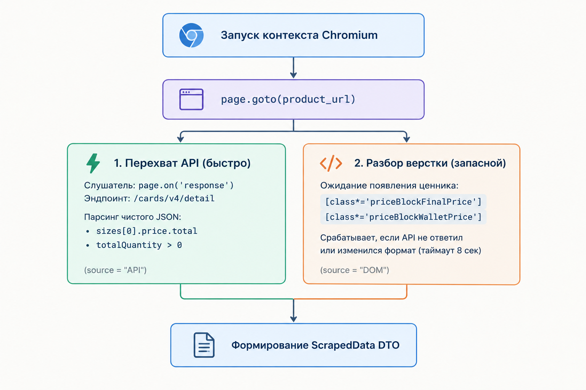

# Модуль сбора данных: Wildberries Scraper

Документ описывает архитектуру и реализацию модуля мониторинга цен и наличия на складе комплектующих с маркетплейса Wildberries.

* Общее описание системы и сущностей БД: [about.md](about.md)
* Стратегия тестирования и тестовые сценарии: [testing.md](testing.md)
* Исходный код скрапера: [src/scrapers/wildberries.py](../src/scrapers/wildberries.py)

---

## 1. Смысл модуля

Модуль `WildberriesScraper` отвечает за изолированное извлечение актуальной стоимости, наименования и доступности товара по переданному URL карточки.

### Интерфейс взаимодействия
Класс наследует базовый интерфейс `BaseScraper` и возвращает строго типизированный DTO `ScrapedData`:

| Поле | Тип | Описание |
| :--- | :--- | :--- |
| `price` | `Optional[Decimal]` | Итоговая цена в рублях (с учетом скидок) |
| `is_in_stock` | `bool` | Флаг наличия товара на складе |
| `raw_title` | `Optional[str]` | Название позиции на маркетплейсе |
| `currency` | `str` | Валюта расчета (по умолчанию `"RUB"`) |
| `status` | `ScrapeStatus` | Статус выполнения операции |
| `source` | `Optional[str]` | Источник данных (`"API"` или `"DOM"`) |

### Состояния `ScrapeStatus`:
* `SUCCESS` — товар найден, цена и остатки успешно получены (`is_in_stock = True`).
* `OUT_OF_STOCK` — карточка товара существует, но товар закончился на складе (`is_in_stock = False`, `price = None`).
* `NOT_FOUND` — артикул удален или не существует (ошибка 404, заглушка площадки).
* `CAPTCHA_OR_BLOCKED` — обнаружен экран проверки на бота (SmartCaptcha, Cloudflare) или блокировка со стороны WAF.
* `PARSING_ERROR` — невалидный формат ссылки, обрыв сети или фатальный таймаут.

---

## 2. Архитектура сбора данных

Wildberries защищает витрину комплексом WAF (`server: wbaas`), который анализирует TLS-фингерпринты (JA3) и отсекает консольные HTTP-клиенты (`requests`, `httpx`). Для обеспечения стабильности используется связка **Playwright (Chromium)** с расширением **`playwright-stealth`**, скрывающим признаки автоматизации.

### 2.1. Как извлекаются данные (API + Fallback)

Парсер работает по принципу «быстрый путь + запасной вариант»: сначала он пытается перехватить чистый JSON из внутреннего API витрины, а если запрос не прошел или изменился — переключается на чтение элементов со страницы (DOM fallback).

1. **Основной способ: перехват сетевого API**
   * Браузер слушает сетевой трафик страницы через `page.on("response", handle_response)`.
   * Когда карточка открывается, сайт Wildberries сам делает фоновый запрос к своему API (`/cards/v4/detail` или `/cards/v2/detail`).
   * Мы перехватываем этот ответ и забираем готовый JSON: цена берется из поля `sizes[0].price.total` (в копейках, переводится в рубли), а остаток — из `totalQuantity`.
   * Как только данные получены, срабатывает событие `asyncio.Event`, и парсер сразу завершает работу. Не нужно ждать загрузки тяжелых картинок, отзывов и скриптов. В поле `source` записывается `"API"`.

2. **Резервный вариант: разбор элементов страницы (DOM Fallback)**
   * Если ответ от API не успел прийти за 8 секунд или маркетплейс поменял структуру JSON, управление переходит к обычному парсингу HTML.
   * Так как Wildberries генерирует случайные хэши в классах (например, `priceBlockFinalPrice--yEKcc`), поиск элементов идет по совпадению подстроки: `[class*='priceBlockFinalPrice']` и `[class*='priceBlockWalletPrice']`.
   * Найденный текст очищается регуляркой от знака рубля и пробелов через `re.sub(r"[^\d]", "", ...)`. В поле `source` записывается `"DOM"`.

---

## 3. Матрица состояний

| Ситуация на витрине | Признаки детекции | `price` | `is_in_stock` | Результирующий `status` |
| :--- | :--- | :---: | :---: | :--- |
| **Товар в наличии** | Цена получена из API или DOM (> 0), остаток > 0 | `Decimal` | `True` | `SUCCESS` |
| **Товар закончился** | Заголовок найден, но остатки = 0 или блок цены пуст | `None` | `False` | `OUT_OF_STOCK` |
| **Товар не существует** | Сработали маркеры ошибки в DOM / API вернул 404 | `None` | `False` | `NOT_FOUND` |
| **Блокировка / Капча** | URL содержит `challenge` / текст SmartCaptcha в DOM | `None` | `False` | `CAPTCHA_OR_BLOCKED` |
| **Некорректная ссылка** | `extract_item_id` не смог извлечь ID из URL | `None` | `False` | `PARSING_ERROR` |

---

## 4. Известные ограничения
1. **Зависимость цен от геолокации:** маркетплейс Wildberries рассчитывает конечную стоимость и доступность позиций с привязкой к конкретному региону/складу доставки. Текущая конфигурация не передает гео-куки и опрашивает базовый центральный регион (Москва / ЦФО).

2. **Затраты вычислительных ресурсов:** использование полноценного headless-браузера потребляет значительно больше ресурсов CPU/RAM по сравнению с прямыми HTTP-запросами, что компенсируется применением семафоров и периодическим запуском воркера.